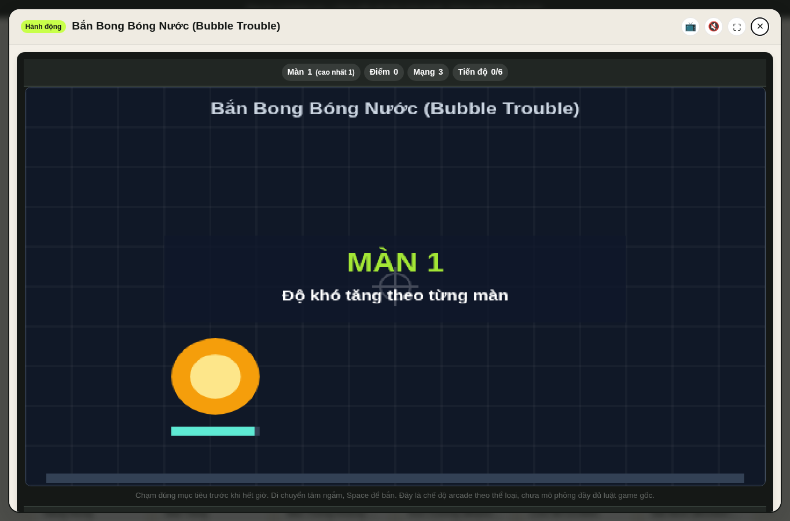
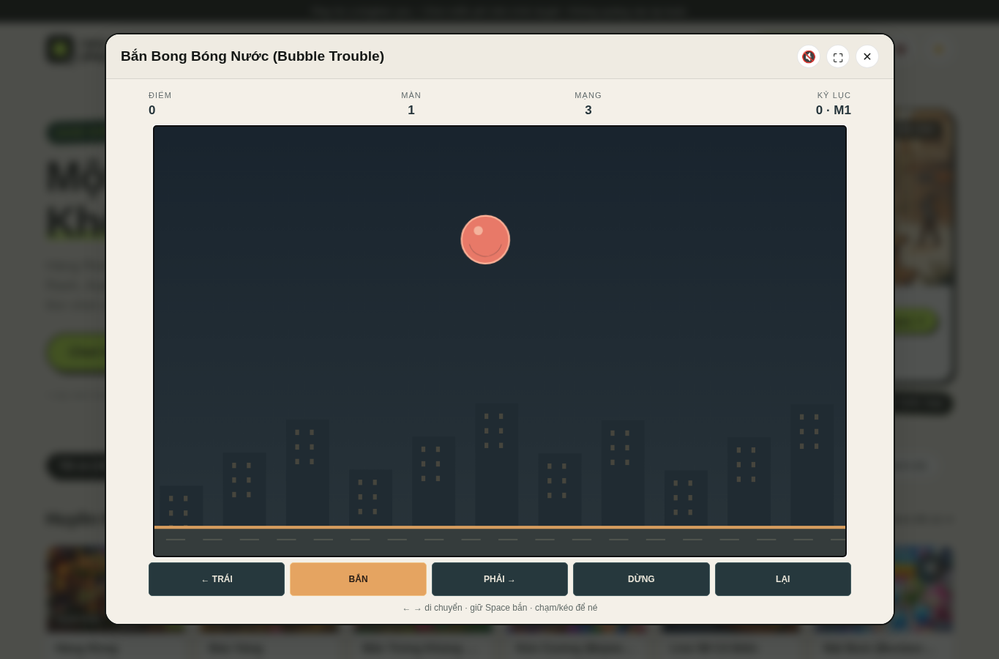
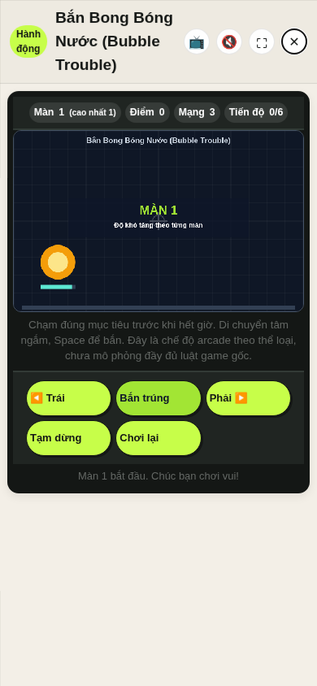
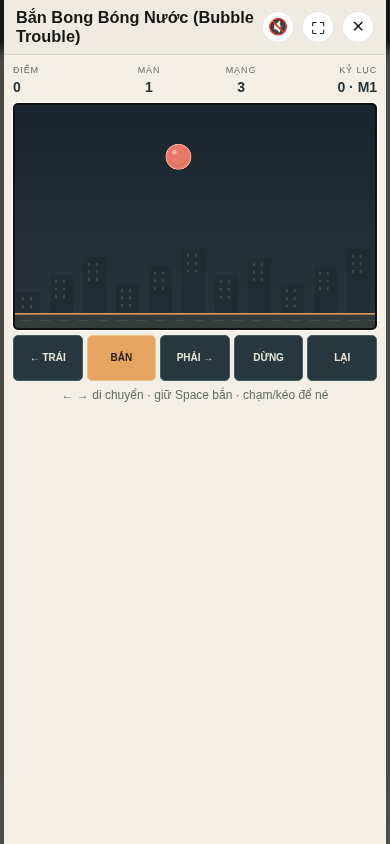

# Bubble Trouble gameplay batch — 2026-10-11

## Scope and baseline

- **Main baseline SHA:** `32e50649ad182bc89e185fd6067287602874079f` (`origin/main` checked before editing).
- **Stack base:** Piano Tiles branch `codex/piano-tiles-gameplay-20261011`, SHA `f0840354dde5bda0fbaf7e81988942d0251a757c`; that branch is PR #6 and still open. The main ref remained at the recorded baseline during this batch.
- **Working branch:** `codex/bubble-trouble-gameplay-20261011`.
- **Catalog entry:** `bong-bong-nuoc-bubble-trouble` / Bắn Bong Bóng Nước (Bubble Trouble).
- **Code and evidence:** `scripts/engines-archetypes.js`, `tests/bubble-trouble-model.test.cjs`, `tests/game-flow.test.cjs`, README, gameplay audit, coverage ledger, [profile](../game-profiles/bubble-trouble-classic.md), and this report/screenshots.
- **Router:** exact-ID dispatch runs the new loop through the existing `NP_Archetypes.launch` call from `launchRetroArcade`. `app.js` and the shared canvas fallback are unchanged.

## Research boundary

The selected reference is the developer-attributed 2025 HTML5 [Bubble Trouble listing on CrazyGames](https://www.crazygames.com/game/bubble-trouble-cpy), read 2026-10-11. The listing documents landscape orientation, one-player left/right and Space controls, a spike gun fired vertically, bubbles splitting into smaller/faster targets, contact costing a life, and clearing the field to proceed. It does not publish this build's exact physics, maps, starting count, score scale, life count or campaign length. This implementation uses its own vector art and ten locally composed stages; it does not copy reference media/code or claim its full stage set.

## Implementation

The dedicated model runs the harpoon, bubble splitting, rebounds, player hitboxes, lives and temporary hit protection, score, stage clear/transition, final win and game-over states separately from rendering. The renderer draws a horizontal 900×560 board, three bubble sizes, a small hunter, the floor line and original night-city silhouettes. Controls are keyboard arrows/A-D and held Space, pointer steering on the board, and held touch buttons. It pauses on request, retries from stage one, records best score/furthest stage in local storage, and uses the project's optional procedural arcade audio cues.

Starting with one large bubble makes stage one a learnable on-ramp. Later stages add initial bubbles; children move faster as they split. Stage counts, speed, gravity, score values, three-life rule and ten-stage finish are local adaptation choices. Co-op, power-ups and the complete 2025 reference campaign are outside scope.

## Browser play and checks

Browser used: system Chromium (`/usr/bin/chromium`), headless, served from this branch's static files. These are simulated viewports, not physical phones.

- Opened the catalog item through `window.openGameById('bong-bong-nuoc-bubble-trouble')` and verified the Bubble Trouble canvas appears rather than `#arcCanvas`.
- At **1365×900**, the landscape board measured about **948×590 px**. At **390×844**, it measured **364×227 px**; at **320×640**, **296×184 px**. Both mobile sizes had zero horizontal overflow. All five touch/control buttons measured **46 px** high.
- Keyboard focus is moved from the modal close button to the game canvas after mount. ArrowRight moved the hunter; holding Space rendered the rising harpoon. Pause/resume and restart worked. Restart returned score/stage/lives to 0/1/3.
- A state-guided browser helper tracked only bubble positions already painted in the canvas and sent real held mouse-pointer input. It did not read or change the live game state. It popped the first large bubble into two medium ones, cleared stage one at **625 points**, and reached stage two with all three lives. The [bubble split](./bubble-trouble-batch-20261011/bubble-split.png) and [stage two](./bubble-trouble-batch-20261011/level-2-live.png) screenshots show those states. The 625-point / stage-two record was written to local storage. A separate run verified that the UI reloaded a saved 515-point / stage-one record after closing and reopening the game.
- A separate state-guided browser helper followed a descending bubble using actual arrow-key input to test player contact. The game reached **0 lives**, showed game over, and the **retry restored 3 lives on stage one**; see [loss](./bubble-trouble-batch-20261011/loss-screen.png) and [retry](./bubble-trouble-batch-20261011/retry-screen.png). This is an automated rule-path check, not a human difficulty assessment.
- An added deterministic model harness then ran an **automated perfect-aim campaign** from stage 1 through the stage 10 victory state. It selected and resolved the split chain with the model's pop resolver, then advanced each real stage-clear timer: initial large-bubble counts were **1, 2, 2, 3, 3, 4, 4, 5, 5, 6**, totaling **245 bubble pops** and **21,875 points**, with all three lives intact. All ten clear transitions completed within 21 × 50ms model ticks; no model stage stalled. This was not browser input or a player run. It checks campaign arithmetic and transition reachability under ideal hits, not human balance or the physical harpoon hit rate.
- On a touch-enabled 390×844 Playwright context, tapping the on-screen fire button produced one Pointer Event. A separate mobile lifecycle check observed an active game session and one scheduled RAF while open, then no active session, pending RAF or game canvas after close. The catalog-wide flow test also opens and closes this exact route under the project's resource-cleanup harness.
- No browser page errors occurred in the recorded runs. Headless render cadence was not measured reliably; no FPS or input-latency result is claimed.

## Before/after screenshots

Captured at identical **1365×900** and **390×844** viewports. Before images were served from the checked main SHA above; after images from this working branch.

| Main SHA, generic reflex canvas | Working branch, dedicated harpoon game |
| --- | --- |
|  |  |
|  |  |

At the old route the canvas showed one timed circular target and crosshair, not the game's split-bubble loop. The desktop screenshot also shows that this batch removes the reflex template's extra in-canvas title and progress bar. The mobile screenshot shows the board and touch controls without the previous generic canvas's horizontal overflow.

## Test status and remaining gaps

After the controlled campaign test was added, `node --test tests/*.test.cjs` passed **83/83 tests**. The eight Bubble Trouble-specific cases cover initial stage, rate-limited fire, split size/speed, wall/floor rebound, lives/invulnerability/game over, stage transition/final victory, the full ten-stage perfect-aim model campaign, and shared keyboard/pointer horizontal clamping. The game-flow suite checks the exact route, one-engine dispatch, open/render/close and generic archetype count. `node --check` passed for the changed engine and both changed test files; `git diff --check` passed. This repository has no build script or separate catalog validator; the full game-flow suite opens and closes all 150 catalog entries.

Still unverified: a human or input-driven browser clear of stages 3–10, difficulty balance for ordinary players, physical Android/iOS devices, assistive technology, audible sound with browser audio enabled, frame-time under load, and level-by-level comparison against the hosted reference. Browser evidence covers stage-one clear and stage-two entry; the all-ten result is model-only with perfect hits.
